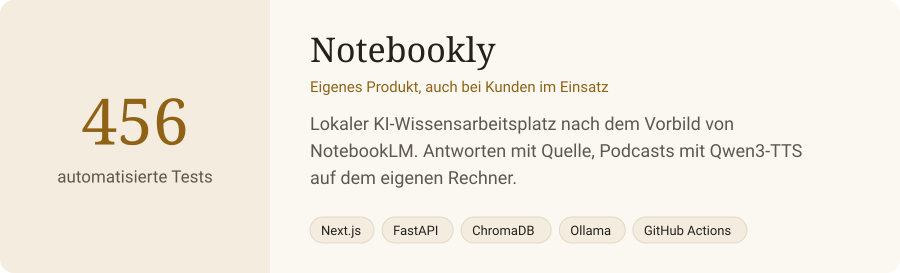
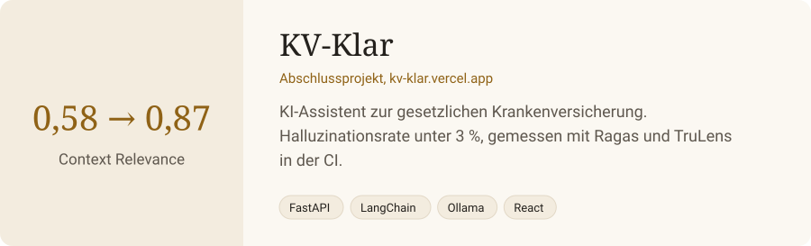
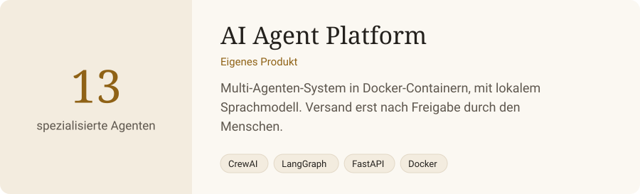
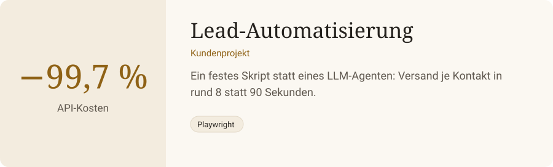
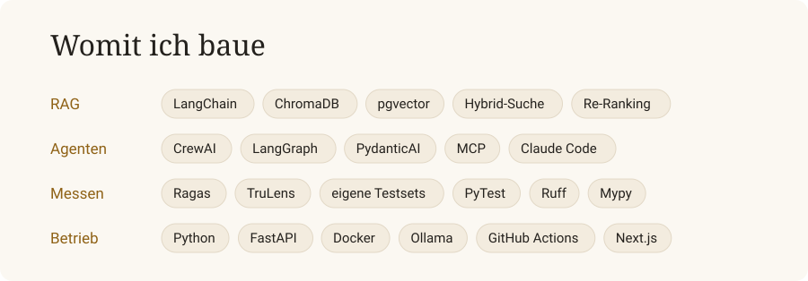
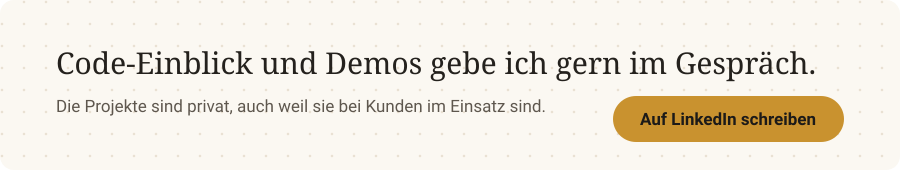

<picture>
  <source media="(prefers-color-scheme: dark)" srcset="assets/hero-dark.svg">
  
</picture>

<picture>
  <source media="(prefers-color-scheme: dark)" srcset="assets/projekt-notebookly-dark.svg">
  
</picture>

<a href="https://kv-klar.vercel.app">
<picture>
  <source media="(prefers-color-scheme: dark)" srcset="assets/projekt-kv-klar-dark.svg">
  
</picture>
</a>

<picture>
  <source media="(prefers-color-scheme: dark)" srcset="assets/projekt-agent-platform-dark.svg">
  
</picture>

<picture>
  <source media="(prefers-color-scheme: dark)" srcset="assets/projekt-lead-automatisierung-dark.svg">
  
</picture>

<a href="https://www.linkedin.com/in/dipl-ing-khesrau-noorzaie/recent-activity/all/">
<picture>
  <source media="(prefers-color-scheme: dark)" srcset="assets/notiz-dark.svg">
  
</picture>
</a>

<picture>
  <source media="(prefers-color-scheme: dark)" srcset="assets/werkzeuge-dark.svg">
  
</picture>

<a href="https://www.linkedin.com/in/dipl-ing-khesrau-noorzaie">
<picture>
  <source media="(prefers-color-scheme: dark)" srcset="assets/kontakt-dark.svg">
  
</picture>
</a>

Die öffentlichen Repositories hier sind Übungsprojekte aus meiner Weiterbildung in Software Engineering mit Spezialisierung AI Engineering (2025).
